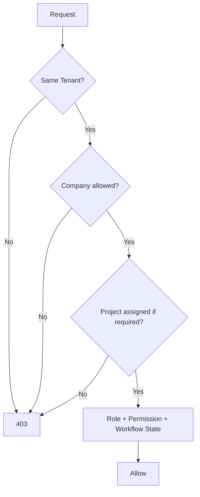
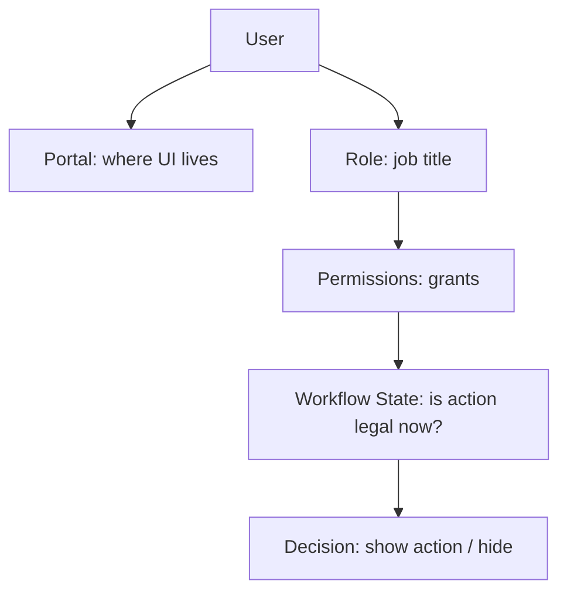
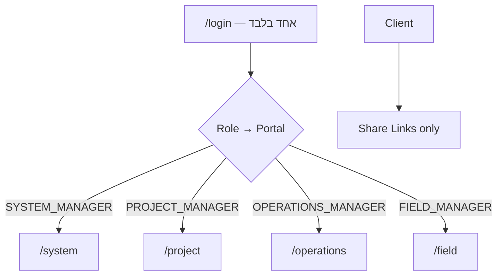
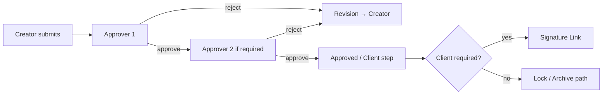
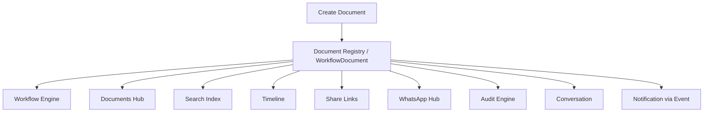
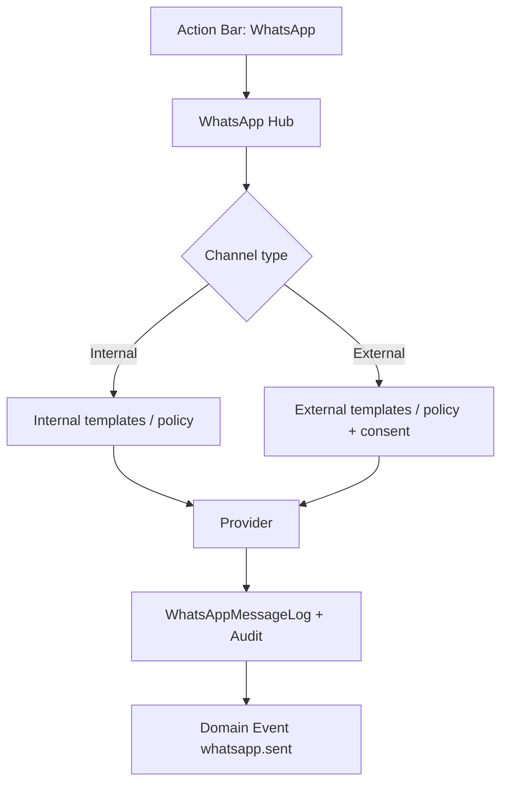
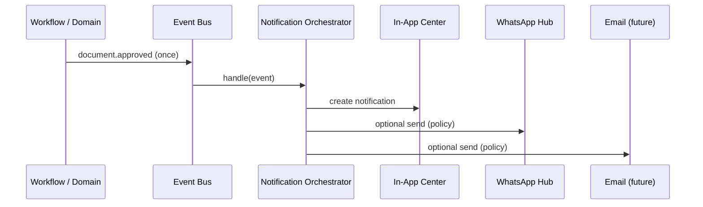
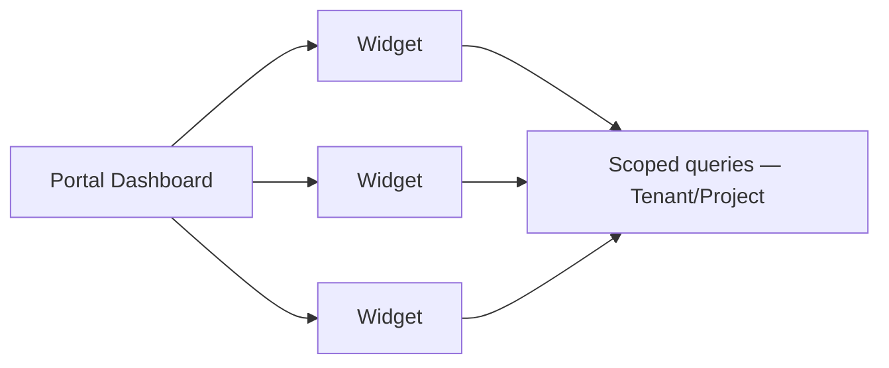
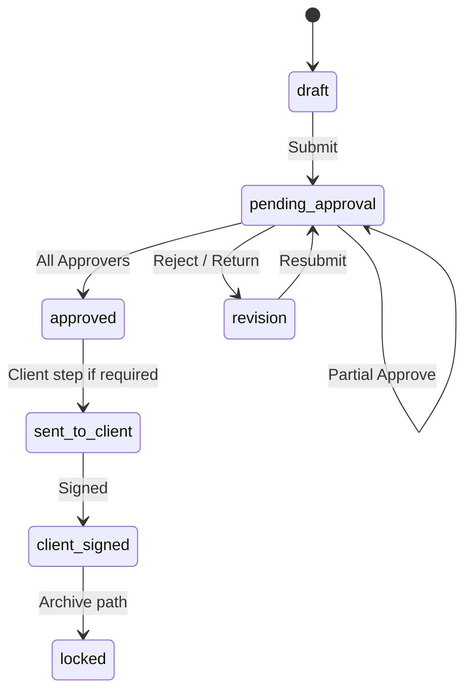

# Architecture Design — Multi-Portal Platform

**סטטוס:** Architecture Approved with Mandatory Completions (Design Only)  
**גרסה:** 3.0  
**תאריך:** 2026-07-23  
**היקף שלב זה:** תכנון (v3.0 אושר). מימוש P1 — ראו `docs/p1-portals-skeleton.md`.

אישור המשתמש ניתן בכפוף להשלמות בסעיפים 1–10 ו־Core Platform Principles להלן.  
לאחר מסמך זה → מעבר לשלב התכנון הבא לפי Roadmap המעודכן (לא מימוש עדיין עד אישור מפורש לכל Phase).

---

## Core Platform Principles

**כל פיתוח עתידי חייב להשתמש במנועים המשותפים. אסור ליצור מנגנון מקביל.**

| Engine | כלל |
|--------|------|
| Workflow Engine | **אחד בלבד** |
| Documents Hub | **אחד בלבד** |
| Notification Engine | **אחד בלבד** |
| WhatsApp Hub | **אחד בלבד** |
| Share Links Engine | **אחד בלבד** |
| Timeline Engine | **אחד בלבד** |
| Conversation Engine | **אחד בלבד** |
| Approval Center | **אחד בלבד** |
| Audit Engine | **אחד בלבד** |
| Document Registry | **אחד בלבד** |
| Event Bus (התראות) | **אחד בלבד** — Event → fan-out לערוצים |

מודול חדש (גם בעוד שנה) **מתחבר** למנועים האלה — לא ממציא Workflow / Inbox / WhatsApp / Audit משלו.

הפרה של עיקרון זה = פסילת Design Review.

---

## 0. מטרת השינוי

היום: כמעט כל המשתמשים באותה מערכת.

היעד: פלטפורמה Multi-Portal + Multi-Tenant.

| עקרון | משמעות |
|--------|---------|
| Portal = סביבת עבודה | Dashboard + Nav + חוויית עבודה |
| Permission = מה מותר | לא נקבע ע״י Portal בלבד |
| Tenant isolation | בידוד מלא בכל Entity |
| Document First | המסמך הוא מרכז המערכת |
| Shared Engines | מנועים משותפים — בלי כפילות |
| PWA | כל Portal = אותו קוד, Responsive |

---

## 1. Multi-Tenant Isolation (חובה)

כל Portal עובד לפי **אותם כללי בידוד**.

### 1.1 שיוך חובה לכל Entity

כל ישות עסקית משויכת לשרשרת:

```
Tenant → Company → Project → Entity
```

| Entity (דוגמאות) | Tenant | Company | Project |
|------------------|:------:|:-------:|:-------:|
| Project | ✅ | ✅ | — (הוא עצמו) |
| WorkflowDocument | ✅ | ✅ | ✅ |
| Document (Hub) | ✅ | ✅ | ✅ |
| WorkflowApproval | ✅ | ✅* | ✅* |
| Timeline / WorkflowEvent | ✅ | ✅* | ✅* |
| Attachment / WorkflowAttachment | ✅ | ✅* | ✅* |
| ConversationMessage | ✅ | ✅* | ✅* |
| ShareLink | ✅ | ✅* | ✅* |
| Notification | ✅ | ✅ | לפי הקשר |
| WhatsAppMessageLog | ✅ | ✅ | ✅* |
| AuditLog | ✅ | ✅ | ✅* |
| ProjectRoom / BOQ / … | ✅ | ✅ | ✅ |

\* דרך המסמך / הפרויקט האב (denormalized או join חובה ב-query).

### 1.2 כללי גישה

```
access(user, entity) =
  user.tenantId == entity.tenantId
  AND user.company scope allows entity.companyId
  AND (אם נדרש project scope) entity.projectId ∈ user.assignedProjectIds
  AND portal allows the surface
  AND permission + workflow state allow the action
```

**אסור** לשום Portal לגשת מחוץ להקצאות (Tenant / Company / Project).



System Manager: רואה בתוך Tenant (או לפי מדיניות על) — **Support Mode** בפרויקט עדיין כפוף ל-Tenant; אין קפיצה בין Tenants בלי הקשר מפורש.

---

## 2. Portal ≠ Permission

**Portal** = סביבת עבודה (איפה המשתמש עובד).  
**Permission** = מה מותר לבצע.

שני Project Managers באותו Portal יכולים לקבל Permissions שונים:

| משתמש | Portal | Role | Permission לדוגמה |
|--------|--------|------|-------------------|
| PM A | Project | PROJECT_MANAGER | `account.approve` ✅ |
| PM B | Project | PROJECT_MANAGER | `account.approve` ❌ |

### שרשרת הרשאה

```
Portal
  ↓
Role
  ↓
Permissions
  ↓
Workflow State
  (+ Tenant / Company / Project scope)
```

**לא** Portal בלבד.



---

## 3. Portal Map + Login



אין 4 מסכי Login. אחרי Login — Redirect לפורטל.

| Portal | Path | Role | Project scope |
|--------|------|------|----------------|
| System | `/system` | SYSTEM_MANAGER | Support Mode בלבד |
| Project | `/project` | PROJECT_MANAGER | מוקצים בלבד |
| Operations | `/operations` | OPERATIONS_MANAGER | מוקצים בלבד |
| Field | `/field` | FIELD_MANAGER | מוקצים בלבד |

---

## 4. Navigation Maps

### System Portal
```
Dashboard (widgets)
Companies · Projects · Users · Roles & Permissions
Workflow Engine · Documents Hub · AI · Settings
Integrations · Finance · Audit · Logs
Support Mode
```

### Project Portal
```
Dashboard (widgets)
Projects → BOQ · Rooms · Execution · Accounts · Documents · Timeline · Reports
Workflow · Approvals · Notifications
```

### Operations Portal
```
Dashboard (widgets)
Approval Center · Documents Review · Exceptions
Progress Monitoring · Reports · Notifications
```

### Field Portal
```
Dashboard (widgets)
Work Diaries · Execution · Photos · Materials · Equipment · Workers
Documents · Notifications
```

---

## 5. Support Mode (System Manager)

- צפייה / Debug / Audit / Troubleshooting בלבד  
- פעולות עסקיות (Approve / Reject / Delete / …) → **Override Workflow בלבד**  
- Override: Reason + Note + Audit + Timeline  
- כפוף ל-Tenant isolation  

---

## 6. Approval Matrix (טבלת חוקים)

זו טבלת החוקים של המערכת. כל Kind חייב שורה ב-Registry + מטריצה זו (ניתנת להרחבה בלי if/else בקוד UI).

| מסמך (Kind) | יוצר (Creator Portal/Role) | מאשר ראשון | מאשר שני | לקוח |
|-------------|----------------------------|------------|----------|------|
| Work Diary | Field / FIELD_MANAGER | Operations | Project | אופציונלי |
| Partial Account | Project / PROJECT_MANAGER | Operations | Owner* | חובה |
| Final Account | Project / PROJECT_MANAGER | Operations | Owner* | חובה |
| Delivery Note | Field / FIELD_MANAGER | Operations | — | לא |
| Purchase Request | Field / FIELD_MANAGER | Project | Finance** | לא |
| Change Order | Project / PROJECT_MANAGER | Operations | Owner* | אופציונלי |
| Site Report | Field / FIELD_MANAGER | Operations | Project | לא |
| Measurement Sheet | Project או Field (לפי הגדרה) | Operations | Project | לא |

\* Owner = בעל פרויקט / תפקיד Owner ב-membership (לא בהכרח System).  
\*\* Finance = Permission `finance.approve` — יכול להיות Role ייעודי או Permission על PM/Ops לפי Tenant.

### כללי מטריצה

1. אין Self-Approval (יוצר ≠ מאשר על אותו שלב).  
2. מספר המאשרים והסדר מוגדרים ב-Registry ל-Kind (לא בקוד מסך).  
3. לקוח = רק דרך Share Link (אין Portal).  
4. שינוי מטריצה = שינוי קונפיגורציה / definitions — לא Fork של מנוע.



---

## 7. Document Registry + Document Types

### 7.1 אין if/else לפי סוג מסמך ב-UI/API

כל סוג נרשם ב-**Document Type Registry**:

```
WORK_DIARY
PARTIAL_ACCOUNT
FINAL_ACCOUNT
DELIVERY_NOTE
PURCHASE_REQUEST
CHANGE_ORDER
SITE_REPORT
MEASUREMENT_SHEET
… (future kinds registered the same way)
```

כל רשומה ב-Registry כוללת לפחות:

| שדה | תיאור |
|-----|--------|
| `kind` | מזהה ייחודי |
| `label` | תווית |
| `approvalMatrix` | יוצר / מאשרים / לקוח |
| `workflowDefinition` | transitions |
| `permissions` | מינימום permissions לפעולות |
| `archiveFolderRules` | Documents Hub folders |
| `shareLinkTypes` | view/sign/pdf/… |
| `whatsappTemplates` | internal/external template keys |
| `payloadEntity` | טבלת תוכן (WorkDiary, …) |

### 7.2 Document Registry Flow (מסמך אחד → כל המנועים)



**אין מסמך "מיוחד"** שעוקף את השרשרת.

---

## 8. Document First

כל Portal מציג את **אותו מסמך** לפי הרשאות. אין שכפול נתונים.

המסמך מחזיק: יוצר, עורכים, מאשרים, סטטוס, קבצים, תגובות, חתימות, צפיות, קישורים, WhatsApp, Notifications, Audit.

---

## 9. Shared Engines (תזכורת)

Workflow · Documents Hub · Notifications · WhatsApp · Share Links · Timeline · Conversation · Approval Center · Audit · Document Registry · Event Bus  

ראה **Core Platform Principles**.

---

## 10. WhatsApp — Internal vs External

שני סוגי שליחה **חובה להגדיר עכשיו** (תבניות ייפרדו בעתיד):

| סוג | כיוון | דוגמה |
|-----|--------|--------|
| **Internal** | משתמש מערכת → משתמש מערכת | Field → Operations: "ממתין לאישורך" |
| **External** | מערכת → גורם חיצוני | System → Client: קישור חתימה |



כל השליחות רק דרך Hub. מודול לא מדבר ישירות עם Provider.

---

## 11. Notification Center — Event אחד → Fan-out

**איסור:** ליצור בנפרד ובלי שליטה Notification + WhatsApp + Email לאותו אירוע.

**חובה:**

```
Domain Event (אחד)
    ↓
Notification Orchestrator
    ↓
├── In-App Notification (אם מופעל)
├── WhatsApp (אם מופעל + Internal/External)
├── Email (אם מופעל — עתידי)
└── Audit (תמיד לפעולות עסקיות)
```



התראה אחת לוגית לכל אירוע; ערוצי משלוח לפי הגדרות Tenant/User/Kind.

דוגמאות אירועים: New Approval · Rejected · Approved · Customer Signed · Returned For Fix · New Comment.

לחיצה ב-In-App → מסמך בפורטל הנכון.

---

## 12. Audit Engine

כל פעולה עסקית נרשמת. מינימום סוגי אירועים:

| Event |
|--------|
| Created |
| Updated |
| Submitted |
| Approved |
| Rejected |
| Returned |
| Shared |
| WhatsApp Sent |
| Customer Signed |
| Override |

שדות מומלצים: `tenantId`, `companyId`, `projectId`, `documentId`, `actorId`, `action`, `before`, `after`, `metadata`, `createdAt`.

Audit **לא ניתן לכיבוי** לפעולות אלה.

---

## 13. Dashboard = Widgets (לא קשיח)

אין Dashboard מונוליטי קשיח.

כל Portal Dashboard = הרכבת **Widgets**:

| Widget (דוגמאות) | Portals |
|------------------|---------|
| Pending Approvals | Project, Ops |
| Today's Tasks | Field, Project |
| Recent Documents | All |
| Exceptions | Ops |
| Charts / KPIs | System, Project, Ops |
| System Health | System |
| Support shortcuts | System |

הוספה/הסרה = קונפיג Widget Registry — לא שכתוב עמוד.



---

## 14. Action Bar + Hide (לא Disable)

View · Edit · Conversation · Timeline · Attachments · Workflow · Submit · Approve · Reject · Generate Link · WhatsApp · PDF · Print · Archive  

אין הרשאה ⇒ **הכפתור לא מוצג**.

---

## 15. Authorization Model

```
authorize =
  Tenant match
  ∩ Company scope
  ∩ Project assignment (אם נדרש)
  ∩ Portal
  ∩ Role
  ∩ Permissions
  ∩ Workflow State
```

### Role × Portal

| Role | System | Project | Operations | Field |
|------|:------:|:-------:|:----------:|:-----:|
| SYSTEM_MANAGER | ✅ | Support | ❌ | ❌ |
| PROJECT_MANAGER | ❌ | ✅ assigned | ❌ | ❌ |
| OPERATIONS_MANAGER | ❌ | ❌ | ✅ assigned | ❌ |
| FIELD_MANAGER | ❌ | ❌ | ❌ | ✅ |

Permissions נפרדות בתוך Role (ראה §2).

---

## 16. Workflow Lifecycle (אחיד)



---

## 17. PWA / Mobile

| כלל | פירוט |
|-----|--------|
| אין Portal נפרד לטלפון | אותו קוד |
| כל Portal = PWA-capable | responsive + installable בהמשך |
| Field / Ops / Project / System | כולם Responsive |
| אין אפליקציה ייעודית לעובד כעת | — |

תכנון טכני עתידי: `manifest` לכל Portal או manifest דינמי לפי path — **בלי fork של לוגיקה עסקית**.

---

## 18. Flows (סיכום)

### Approval
Field/PM Submit → Event → Approval Center → Ops/PM Approve/Reject → Event → Notifications fan-out → (optional) Client Link.

### Share Links
Generate (view/approval/sign/pdf/temp/secure) → token → Guest → validate → render.

### WhatsApp
Action Bar → Hub → Internal|External → Provider → Log → Event `whatsapp.sent`.

### Support Mode
System → enter project read-only → business action → Override only → Audit.

---

## 19. Gap Analysis (Existing → Target)

| נושא | קיים | יעד v3 |
|------|------|--------|
| Tenant/Company/Project על כל Entity | חלקי / לא אחיד | חובה בכל Entity |
| Portal vs Permission | Role≈מסך | Portal ≠ Permission |
| Approval Matrix | חלקי ביומן | מטריצה מלאה ב-Registry |
| Document Registry | חלקי (Workflow kinds) | Registry מלא לכל מסמך |
| WhatsApp Internal/External | חסר | שני סוגים ב-Hub |
| Notifications fan-out | createMany נקודתי | Event אחד → Orchestrator |
| Audit coverage | חלקי | כל פעולה עסקית מהרשימה |
| Dashboard | קשיח יחסית | Widgets |
| Document types | if/else בסיכון | Registry |
| PWA | Field mobile חלקי | כל Portal Responsive/PWA |
| Dual engines | סיכון במודולים ישנים | אסור — Core Principles |

---

## 20. Roadmap (סדר עבודה מאושר לתכנון)

| Phase | תוכן | הערה |
|-------|------|------|
| **P0** | אישור הארכיטקטורה הסופית (מסמך זה) | ✅ מאושר עם השלמות |
| **P1** | Portals (shells + login router + isolation boundaries) | ✅ |
| **P2** | Navigation לכל Portal | ✅ Sprint 1 Demo |
| **P3** | Authorization (Portal access by Roles) | ✅ Soft boundary — Tenant isolation בהמשך |
| **P4** | Dashboard Widgets | ✅ ראשוני (live counts) |
| **P5** | Approval Center | ✅ מחובר ל־Approvals Inbox הקיים |
| **P6** | Notification Center + Event Orchestrator | ✅ Center חי; Orchestrator מלא בהמשך |
| **P7** | Conversation (+ Timeline binding) | ✅ על WorkflowEvent |
| **P8** | WhatsApp Hub (Internal/External) | ✅ תשתית + UI (wa.me) |
| **P9** | Share Links | ✅ Hub על Sign Tokens קיימים |
| **P10** | Migration + QA + Audit completeness | 🔄 QA פנימי Sprint 1 — ראו `docs/sprint1-client-demo.md` |

P0–P1 הושלמו.  
**Sprint 1 Client Demo** מחבר את הפלטפורמה לבדיקות לקוח — פירוט ב־`docs/sprint1-client-demo.md`.

---

## 20.1 Future Portals (ארכיטקטורה פתוחה)

הארכיטקטורה **חייבת לאפשר** הוספת Portal נוסף בלי לשנות מנועים משותפים.

| Future Portal (דוגמאות) | נתיב לדוגמה |
|-------------------------|-------------|
| Finance Portal | `/finance` |
| Customer Portal | `/customer` |
| Supplier Portal | `/supplier` |
| Inspector Portal | `/inspector` |

**כלל הוספה:** `PortalDefinition` + route group + מיפוי role→home בלבד.  
אין מנוע Workflow / Documents / Notification / WhatsApp חדש לכל Portal.

ה־Portals בפרודקשן כרגע: System / Project / Operations / Field.  
Future Portals = יכולת ארכיטקטונית — לא התחייבות למימוש מיידי.

---

## 21. Architecture Principles (מלא)

1. Portal אחד לכל סוג משתמש; Login אחד.  
2. Portal ≠ Permission.  
3. Multi-Tenant: כל Entity עם Tenant + Company + Project.  
4. Document First + Document Registry אחד.  
5. Approval Matrix כטבלת חוקים — לא לוגיקה במסך.  
6. מנועים משותפים בלבד — ראה Core Platform Principles.  
7. Event אחד → fan-out להתראות.  
8. WhatsApp: Internal / External דרך Hub בלבד.  
9. Audit על כל פעולה עסקית מהרשימה.  
10. Dashboard = Widgets.  
11. Hide לא Disable.  
12. אין Self-Approval; Override רק System + Reason/Note/Audit/Timeline.  
13. Support Mode ל-System בפרויקט.  
14. PM/Ops/Field — רק פרויקטים מוקצים.  
15. PWA/Responsive — אין Portal טלפון נפרד.  
16. אין Portal לעובד; אין Portal ללקוח.

---

## 22. Deliverables Checklist (v3)

| Deliverable | סעיף |
|-------------|------|
| Core Platform Principles | ראש המסמך |
| Multi-Tenant rules | §1 |
| Portal ≠ Permission | §2 |
| Portal Map + Login | §3 |
| Navigation Maps | §4 |
| Support Mode | §5, §18 |
| Approval Matrix | §6 |
| Document Registry + Types | §7 |
| Document First | §8 |
| WhatsApp Internal/External | §10 |
| Notification Event fan-out | §11 |
| Audit events | §12 |
| Dashboard Widgets | §13 |
| Action Bar | §14 |
| Auth model | §15 |
| Workflow lifecycle | §16 |
| PWA / Mobile | §17 |
| Gap Analysis | §19 |
| Roadmap P0–P10 | §20 |
| Mermaid diagrams | לאורך המסמך |

---

**סוף Architecture v3.0 — Approved with Mandatory Completions (Design).**  
השלב הבא לפי הסדר: **תכנון מפורט ל-P1 (Portals)** — רק לאחר הנחיה מפורשת להתחיל את אותו שלב.
